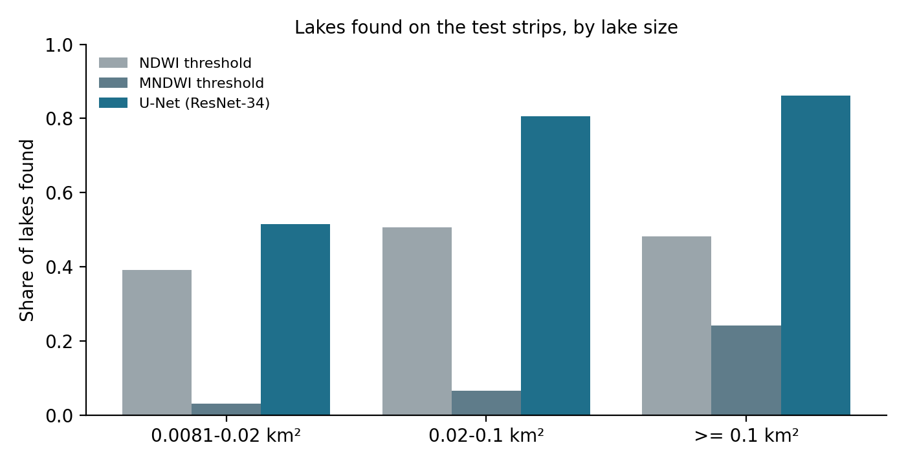
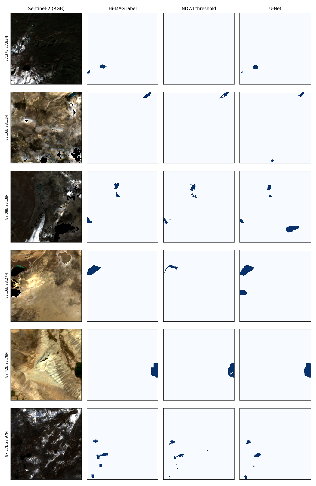
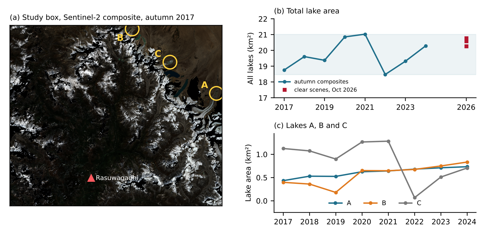

# Mapping glacial lakes in the Nepal Himalaya with Sentinel-2

On 8 July 2025 a flood came down the Lende river into the Bhotekoshi at Rasuwagadhi, destroyed the
Friendship Bridge to China and killed several people. It was traced to a lake on the surface of the
Purepu glacier in Gyirong, Tibet, about 35 km upstream. On 26 August 2026 the same valley flooded again; early
assessments point to an ice avalanche that dammed the Lende near the border and then broke through.
Both times people downstream had almost no warning, and both floods started in high, remote
headwaters that are rarely watched.

**Paper:** [Mapping glacial lakes in the central Himalaya with Sentinel-2 (PDF)](paper/Dahal_2026_glacial_lake_mapping.pdf), also on [my website](https://subarna007.github.io/personalwebsite/#glacial).

Sentinel-2 photographs every part of the Himalaya every five days for free. This project asks two questions:

1. **How well can a segmentation model find glacial lakes in Sentinel-2 images, compared with the
   usual water-index thresholds (NDWI, MNDWI)?** Tested on parts of the Himalaya the model never saw.
2. **What does the model show for the Lende and upper Bhotekoshi catchments** from 2017 to 2025, and
   around the 2025 and 2026 floods?

## Data

| What | Source |
|---|---|
| Images | Sentinel-2 Level-2A surface reflectance, bands B2, B3, B4, B8 (10 m) and B11, B12 (20 m, resampled to 10 m), from the Microsoft Planetary Computer |
| Lake outlines (labels) | Hi-MAG, the annual glacial lake inventory of High Mountain Asia 2008-2017 (Chen et al., 2021). Mapped from Landsat and checked by hand. I use the 2017 outlines. |
| Study area | 84.0-88.5 E, 27.6-29.6 N: the Nepal Himalaya and the Tibetan side of the border |

## Method

**Images.** For each location I take every Sentinel-2 scene from 15 September to 30 November 2017
(after the monsoon, when there is the least cloud and seasonal snow), mask cloud, cloud shadow and
cirrus with the scene classification layer, and take the per-pixel median. Scenes processed after
25 January 2022 carry a +1000 reflectance offset; it is removed so all years are comparable.

**Tiles.** The area is cut into 256 x 256 pixel tiles (2.56 km). I keep up to 900 tiles that contain
a Hi-MAG lake and half as many lake-free tiles from the same mountain terrain, so the model also
sees rivers, shadows, snow and ice that are *not* lakes.

**Split.** Tiles are split by longitude, not at random, because neighbouring tiles look alike and a
random split would overestimate accuracy:

| Split | Longitude |
|---|---|
| Test | 84.5-85.0 E and 87.0-87.5 E |
| Validation | 86.0-86.5 E |
| Training | everything else |

Tiles within about one tile of a strip edge are dropped. The Lende / upper Bhotekoshi area
(85.15-85.75 E, 28.20-28.65 N) is excluded from training altogether.

**Models.**
- *NDWI* and *MNDWI* thresholds. The threshold is chosen on the training and validation tiles.
- *U-Net* with a ResNet-34 encoder (ImageNet weights, first layer adapted to six bands), trained for
  40 epochs with cross-entropy plus Dice loss, random rotations and flips. The checkpoint and the
  probability threshold are chosen on the validation strip.

**Evaluation** on the test strips only:
- pixel IoU, F1, precision and recall, with 95% bootstrap intervals over tiles;
- the share of Hi-MAG lakes found (at least half of the lake predicted as water), by lake size;
- false lakes per 100 km² (predicted water bodies that touch no labelled lake).

Lakes smaller than 81 pixels (0.0081 km², the Hi-MAG minimum) are not counted in the lake-level scores.

**Monitoring.** The trained model is run over the Lende / upper Bhotekoshi box on one post-monsoon
composite per year (2017-2025). Each lake is followed through the years as one connected region of
the union of all yearly masks, so a lake that grows or splits keeps one id. Separately, every clear
single scene from May-August 2025 and July-October 2026 is checked to see whether lakes appear or
disappear around the two floods.

## Results

### Held-out test strips

160 test tiles (1,049 km²) with 170 Hi-MAG lakes, in two longitude strips the model never saw.

| Method | Threshold | IoU (95% CI) | F1 | Precision | Recall | Lakes found | False lakes per 100 km² |
|---|---|---|---|---|---|---|---|
| NDWI | 0.30 | 0.490 (0.414-0.570) | 0.658 | 0.819 | 0.550 | 45.9% | 0.3 |
| MNDWI | 0.70 | 0.039 (0.015-0.075) | 0.076 | 0.045 | 0.244 | 8.2% | 38.7 |
| **U-Net (ResNet-34)** | 0.65 | **0.669 (0.582-0.737)** | **0.802** | **0.861** | **0.750** | **70.6%** | 11.5 |

| Lake size | Lakes | NDWI | MNDWI | U-Net |
|---|---|---|---|---|
| 0.0081-0.02 km² | 64 | 39.1% | 3.1% | 51.6% |
| 0.02-0.1 km² | 77 | 50.6% | 6.5% | 80.5% |
| ≥ 0.1 km² | 29 | 48.3% | 24.1% | 86.2% |

- The U-Net beats NDWI on every pixel score and finds about 1.5 times as many lakes. The gain is biggest
  for medium lakes (0.02-0.1 km²), which NDWI misses when they are dark, shadowed or partly frozen.
- MNDWI fails here: snow and ice look like water to it, and its best threshold sat at the top of the
  search grid.
- The U-Net makes more false detections (11.5 vs 0.3 per 100 km²). Part of this comes from gaps where
  every scene was masked as cloud shadow: often these gaps *are* dark lakes, and the network fills them
  in. Pixel scores ignore gaps; in this first run the lake-level scores did not. The evaluation code now
  ignores predictions in gaps, so the lake-level numbers above will change slightly on a re-run.





### Lende and upper Bhotekoshi, 2017-2024



- 72-91 lakes per autumn, 18.5-21.0 km² in total (mean 19.7, SD 0.9). No steady trend.
- Four of the five largest lakes changed by less than 2% between 2017 and 2024, so the model gives
  consistent outlines for the same lake from different years' images.
- **Lake A (28.483 N, 85.735 E) grew every year, from 0.43 to 0.73 km² (+69%).** Lake B (28.642 N,
  85.490 E) roughly doubled (0.40 to 0.83 km²). Lake C dropped to almost nothing in 2022 and came back,
  which is almost certainly ice or snow in that composite, not a real change.
- The **2025** autumn composite came out with impossible band values (almost no red or green, very
  high blue) and was excluded. The code now rejects such composites automatically.

### Around the floods

- **2026:** the last clear scene before the flood was on 12 August and the next on 1 October. For seven
  weeks, including the day of the flood, there was no clear optical image of the valley. The three
  full-coverage scenes after the flood (1, 21 and 26 October) give 20.3-20.8 km² of lakes, inside the
  2017-2024 range: no sign that a large lake drained.
- **2025:** the pre-flood scenes only covered part of the box (the edge of the satellite's swath runs
  through it) and many lakes were still frozen in May and June, so they cannot show whether the source
  lake was visible beforehand.

**Main lesson:** the U-Net is clearly better than an index threshold, but the real limit for warnings in
this valley is monsoon cloud. Radar (Sentinel-1) is the obvious next step.

All numbers: `results/metrics.json`, `results/monitor/*.csv`.

## Limitations

- **Labels are 30 m, images are 10 m.** Hi-MAG outlines come from Landsat, so lake edges in the
  labels are blocky. This limits the best IoU any model can reach against them.
- **Label and image dates differ.** Hi-MAG 2017 uses one Landsat scene per lake between July and
  November; my images are a September-November median. Lakes that changed within that window will
  look like errors.
- **Autumn composites miss short-lived lakes.** The 2025 flood came from a supraglacial lake that
  formed and drained within weeks in early summer. A once-a-year autumn map would not show it; that is
  why the single-scene check around each flood is part of the project.
- **Frozen lakes, shadow and turbid water** are the expected hard cases for every method.

## What could be explored next

- Train on Sentinel-1 radar, alone or with Sentinel-2, to see through monsoon cloud.
- Find the 2025 source lake on the Purepu glacier and follow it scene by scene through June and July 2025.
- Add elevation and slope from a DEM to separate lakes from shadow and rivers.
- Use a stack of scenes instead of one median: shadows move, lakes do not.
- Train on newer, 10 m inventories; test on other basins and with more seeds.

## Repository

```
src/
  config.py      regions, years, bands, split
  labels.py      download Hi-MAG and keep the 2017 lakes in the study area
  imagery.py     Sentinel-2 search, cloud masking, median composites
  chips.py       training tiles and label rasters
  split.py       train / validation / test strips
  indices.py     NDWI, MNDWI and threshold search
  train.py       U-Net training
  evaluate.py    test-strip comparison, tables and figures
  lakes.py       sliding-window prediction, small-object removal, lake tracking
  monitor.py     Lende / upper Bhotekoshi time series and flood-window scenes
  metrics.py     IoU, F1, lake-level recall, bootstrap
tests/           checks for the parts that do not need imagery
notebooks/       the whole pipeline in one notebook
results/         metrics, tables, figures and the Lende time series
paper/           the write-up (LaTeX source and PDF)
```

## Running it

```bash
pip install -r requirements.txt
python -m pytest tests
python -m src.labels      # Hi-MAG 2017 lakes in the study area
python -m src.chips       # Sentinel-2 tiles (needs internet, takes a while)
python -m src.train       # needs a GPU
python -m src.evaluate
python -m src.monitor
```

## References

- Chen, F., Zhang, M., Guo, H., Allen, S., Kargel, J. S., Haritashya, U. K. and Watson, C. S. (2021).
  Annual 30 m dataset for glacial lakes in High Mountain Asia from 2008 to 2017. *Earth System Science
  Data*, 13, 741-766. https://doi.org/10.5194/essd-13-741-2021
- McFeeters, S. K. (1996). The use of the Normalized Difference Water Index (NDWI) in the delineation
  of open water features. *International Journal of Remote Sensing*, 17(7), 1425-1432.
- Xu, H. (2006). Modification of normalised difference water index (NDWI) to enhance open water
  features in remotely sensed imagery. *International Journal of Remote Sensing*, 27(14), 3025-3033.
- Ronneberger, O., Fischer, P. and Brox, T. (2015). U-Net: Convolutional networks for biomedical image
  segmentation. *MICCAI*.
- ICIMOD situation updates on the Rasuwa floods of July 2025 and August 2026. https://www.icimod.org
